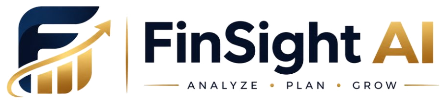
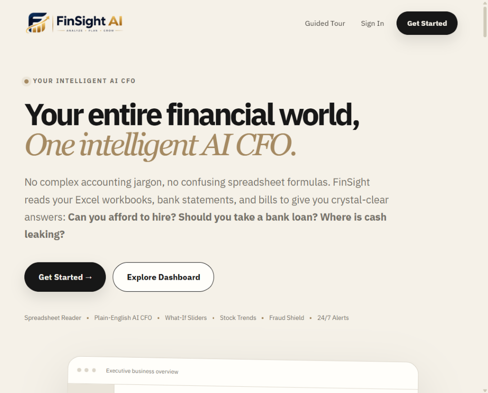
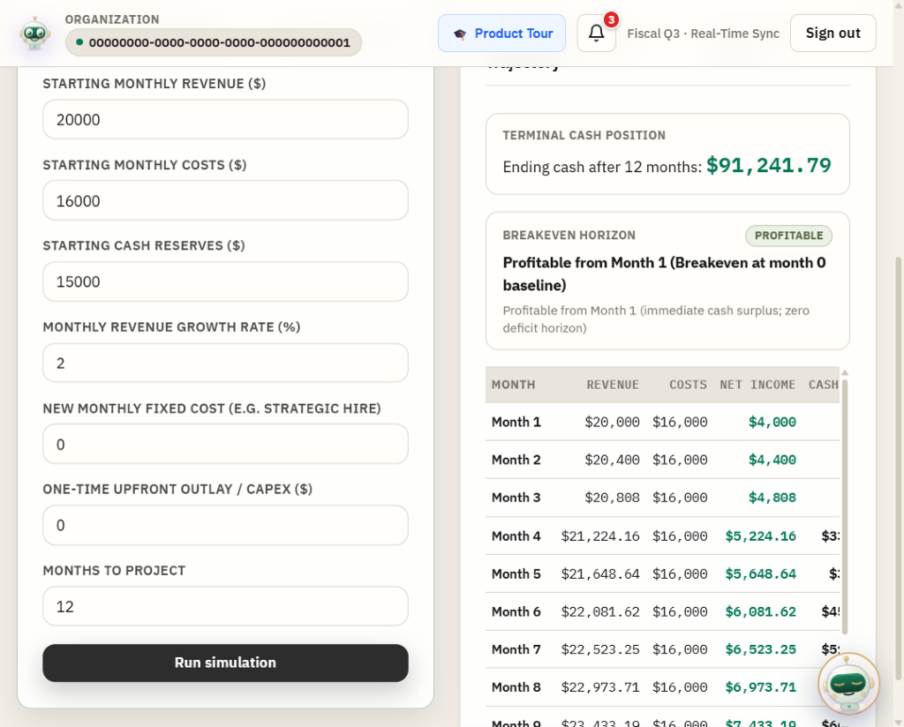
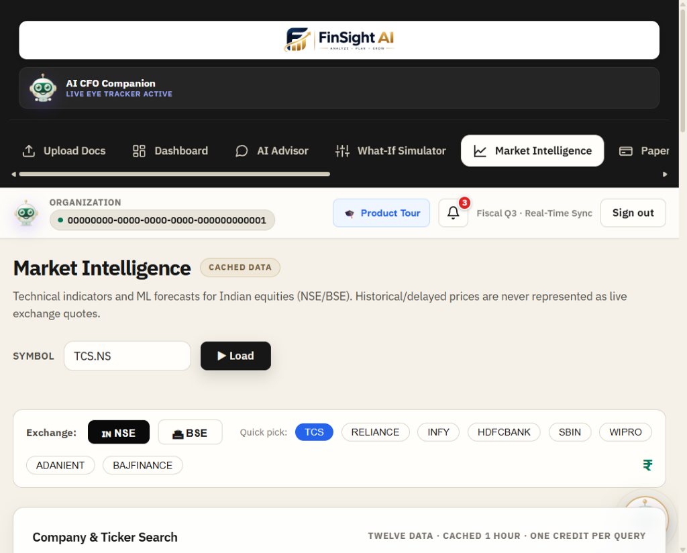
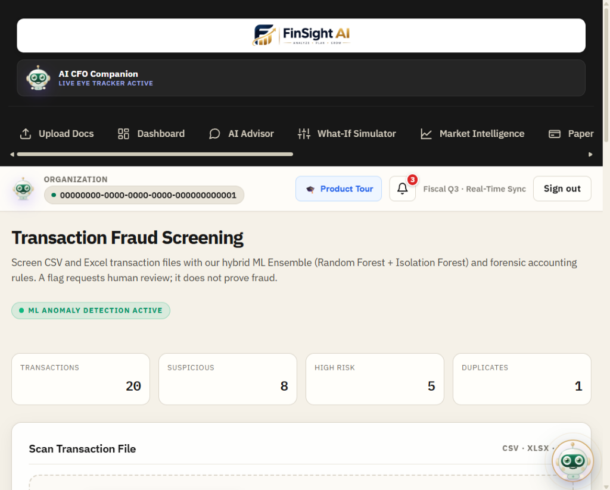
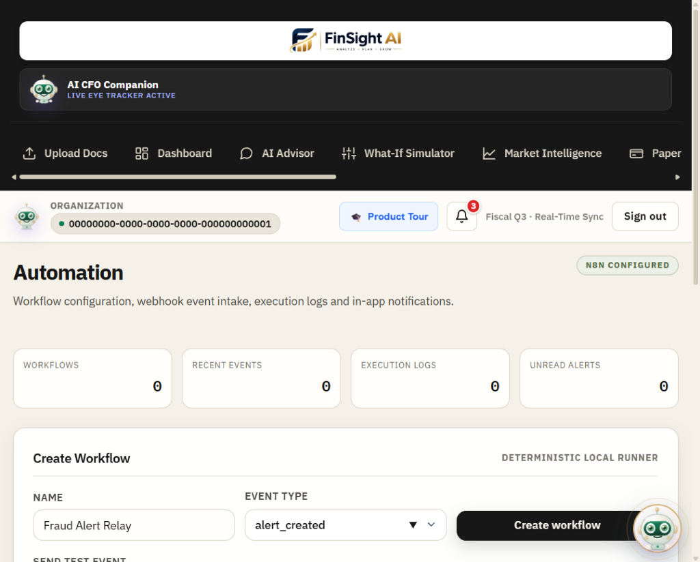
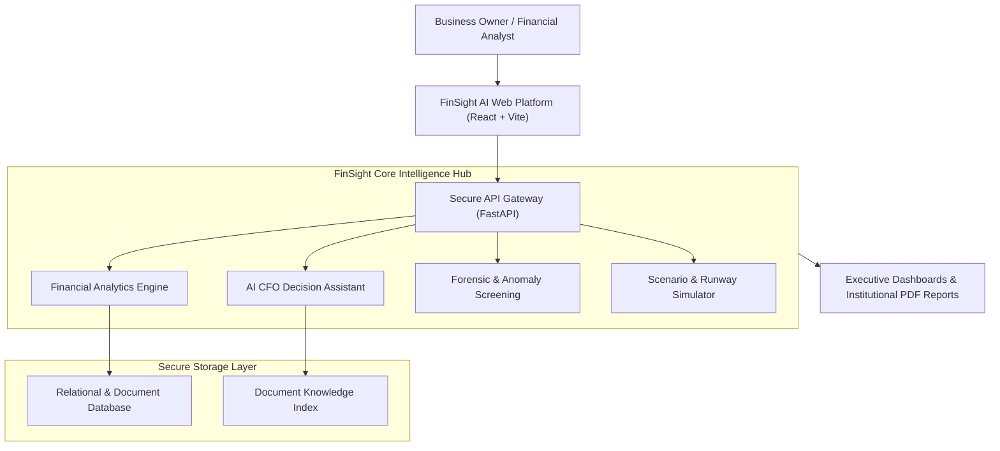
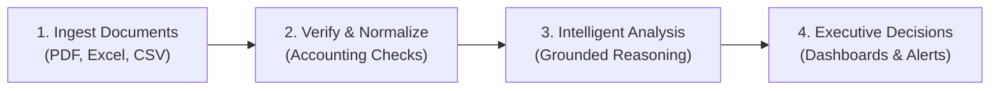

# FinSight AI — Intelligent Financial Intelligence & Virtual AI CFO

<p align="center">
  
</p>

<p align="center">
  <strong>Enterprise financial intelligence, AI CFO advisory, anomaly screening, what-if scenario forecasting, and automated risk governance for modern businesses.</strong>
</p>

<p align="center">
  <a href="#license"></a>
  <a href="https://fastapi.tiangolo.com"></a>
  <a href="https://react.dev"></a>
  <a href="https://vitejs.dev"></a>
  <a href="https://render.com"></a>
</p>

---

## 🌐 Live Application Overview

FinSight AI provides web services and API endpoints:

| Service | Target URL | Description | Status |
|:---|:---|:---|:---:|
| **Frontend Web App** | [https://finsight-frontend-2w1v.onrender.com](https://finsight-frontend-2w1v.onrender.com) | Interactive React + Vite SPA with AI CFO avatar |  |
| **Backend REST API** | [https://finsight-backend-kxfy.onrender.com](https://finsight-backend-kxfy.onrender.com) | FastAPI asynchronous engine & analytical router |  |
| **Interactive API Documentation** | [https://finsight-backend-kxfy.onrender.com/docs](https://finsight-backend-kxfy.onrender.com/docs) | Swagger UI for endpoint exploration |  |
| **Health Check Endpoint** | [https://finsight-backend-kxfy.onrender.com/health](https://finsight-backend-kxfy.onrender.com/health) | Service uptime and status monitor |  |

> *Note:* Free-tier cloud instances spin down during inactivity and may take 30–50 seconds to initialize on the first request.

---

## 💡 What is FinSight AI?

**FinSight AI** bridges the gap between raw corporate records (annual reports, multi-tab financial spreadsheets, bank statements, and transaction ledgers) and strategic executive decision-making. 

FinSight AI is built on a **deterministic verification foundation**. Key metrics, liquidity ratios, and runway projections are grounded in source records and validated against standard accounting principles, helping business leaders make informed capital decisions with confidence.

### 🌟 Platform Highlights

- **Executive Financial Dashboard:** Instant clarity on revenue, operating margins, cash balance history, and key solvency ratios.
- **AI Virtual CFO Advisor:** Source-grounded conversational assistant providing clear, plain-English answers to complex business queries.
- **Forensic Screening & Anomaly Shield:** Intelligent review of transaction ledgers to flag duplicates, unusual patterns, and reporting ceiling thresholds.
- **What-If Scenario Simulator:** Interactive forecasting sliders to simulate revenue trajectories, hiring plans, and cash runway.
- **Market Intelligence & Paper Trading:** Track equity trends, sector benchmarks, and practice treasury management in a risk-free environment.
- **Automated Alerts & PDF Reports:** Proactive notification triggers for budget breaches and institutional-grade financial statement export.

---

## 📸 Complete Visual Tour & Interface Walkthrough

Explore every screen across the FinSight AI application:

### 1. Landing Page & Executive Overview
Modern dark-theme landing portal presenting the AI CFO value proposition and platform capabilities.


### 2. Interactive AI CFO Authentication
Secure sign-in interface featuring the animated AI CFO robot companion with dynamic feedback and multi-mode authentication.


### 3. Multi-Format Financial Document Ingestion Hub
Dropzone supporting `.pdf`, `.docx`, `.xlsx`, `.xls`, and `.csv` files with workspace history and instant indexing.


### 4. Executive Financial Dashboard
High-level statement fundamentals matrix, liquidity alerts, revenue/profit trends, and cash balance trajectories.


### 5. Detailed Financial Ratios Ledger
Full ledger of computed liquidity, leverage, solvency, and profitability ratios with benchmark interpretations.


### 6. AI Financial Advisor with Source Citations
Conversational intelligence interface providing answers cross-referenced against uploaded business documents.


### 7. What-If Scenario Modeling Simulator
Interactive sliders and parameter controls to simulate revenue trajectories, hiring costs, capex outlays, and cash runway.


### 8. Real-Time Market Intelligence
Technical analysis suite featuring candlestick charting, moving averages, momentum indicators, and trend forecasts.


### 9. Paper Trading Simulator & Virtual Treasury
Simulate investment strategies and capital allocation without financial risk. Includes order tickets and portfolio tracking.


### 10. Corporate Money Management & Liquidity Control
Comprehensive treasury management overview covering cash flow runways, working capital cycles, and capital structure.


### 11. Transaction Fraud & Anomaly Screening
Review transactions for duplicate entries, unusual vendor amounts, and threshold compliance.


### 12. Automated Workflow Orchestration
Event dispatcher and background rule engine connecting file ingestion, risk screens, and automated alerts.


### 13. Executive PDF Financial Reports Generator
Export institutional management reports containing comparative period balance sheets, income statements, and ratio analyses.


### 14. Real-Time Alert & Risk Monitoring Stream
Audit stream receiving live incident alerts, budget variance notifications, and liquidity warnings.


---

## 🏗️ High-Level Architecture & Workflow

FinSight AI employs a clean, modular architecture designed for security, auditability, and responsive client interactions.

### High-Level System Architecture



---

### End-to-End Processing Flow



---

## 🛠️ Technology Stack

| Layer | Technologies | Purpose |
|:---|:---|:---|
| **Frontend** | React 18, TypeScript, Vite | Responsive single-page web application |
| **Styling** | Design Tokens, CSS Variables | Dark-aesthetic UI system with animated SVG avatars |
| **Backend API** | Python, FastAPI, Uvicorn | Asynchronous RESTful API services |
| **Database & Search** | Relational Database, Vector Indexing | Secure multi-tenant workspace data persistence |
| **AI Layer** | Model Router, Document Retrieval | Context-aware decision support and conversational advisory |
| **Reporting** | Programmatic PDF Engine | Executive financial report generation |
| **Market Data** | Financial Market APIs | Equities tracking and benchmark data feeds |

---

## ⚖️ Legal & Financial Disclaimer

> [!IMPORTANT]
> **FinSight AI is a financial intelligence and decision-support tool.**
> All calculated ratios, anomaly flags, what-if projections, and AI advisor statements are based on user-provided corporate records and third-party market data feeds. 
> 
> Outputs generated by FinSight AI do **NOT** constitute:
> - An audit, assurance, or certified forensic accounting opinion;
> - Legal, regulatory, or tax advice;
> - Registered investment advice or buy/sell recommendations.
> 
> Always verify critical numbers against original corporate filings and consult certified financial planners and chartered accountants before executing financial agreements or capital investments.

---

## 📄 License

This project is licensed under the **MIT License**.

```text
MIT License

Copyright (c) 2026 Lingeshkumar24-code

Permission is hereby granted, free of charge, to any person obtaining a copy
of this software and associated documentation files (the "Software"), to deal
in the Software without restriction, including without limitation the rights
to use, copy, modify, merge, publish, distribute, sublicense, and/or sell
copies of the Software, and to permit persons to whom the Software is
furnished to do so, subject to the following conditions:

The above copyright notice and this permission notice shall be included in all
copies or substantial portions of the Software.

THE SOFTWARE IS PROVIDED "AS IS", WITHOUT WARRANTY OF ANY KIND, EXPRESS OR
IMPLIED, INCLUDING BUT NOT LIMITED TO THE WARRANTIES OF MERCHANTABILITY,
FITNESS FOR A PARTICULAR PURPOSE AND NONINFRINGEMENT. IN NO EVENT SHALL THE
AUTHORS OR COPYRIGHT HOLDERS BE LIABLE FOR ANY CLAIM, DAMAGES OR OTHER
LIABILITY, WHETHER IN AN ACTION OF CONTRACT, TORT OR OTHERWISE, ARISING FROM,
OUT OF OR IN CONNECTION WITH THE SOFTWARE OR THE USE OR OTHER DEALINGS IN THE
SOFTWARE.
```

For full legal terms, refer to the [LICENSE](LICENSE) file.

---

<p align="center">
  Built with ❤️ for modern businesses and financial decision-makers.
</p>
