# FinSight AI — Intelligent Financial Intelligence & Virtual AI CFO

<p align="center">
  
</p>

<p align="center">
  <strong>Enterprise-grade financial intelligence, multi-agent RAG deliberation, forensic fraud detection, causal what-if scenario forecasting, and automated risk governance for modern businesses.</strong>
</p>

<p align="center">
  <a href="https://github.com/Lingeshkumar24-code/finsight-ai/actions/workflows/ci.yml"></a>
  <a href="#license"></a>
  <a href="https://fastapi.tiangolo.com"></a>
  <a href="https://react.dev"></a>
  <a href="https://vitejs.dev"></a>
  <a href="https://supabase.com"></a>
  <a href="https://render.com"></a>
</p>

---

## 🌐 Live Production Deployments

FinSight AI is continuously deployed and verified across frontend and backend services:

| Component | Target URL | Description | Status |
|:---|:---|:---|:---:|
| **Frontend Web App** | [https://finsight-frontend-2w1v.onrender.com](https://finsight-frontend-2w1v.onrender.com) | Interactive React + Vite SPA with AI CFO avatar |  |
| **Backend REST API** | [https://finsight-backend-kxfy.onrender.com](https://finsight-backend-kxfy.onrender.com) | FastAPI asynchronous engine & LLM router |  |
| **Interactive OpenAPI Docs** | [https://finsight-backend-kxfy.onrender.com/docs](https://finsight-backend-kxfy.onrender.com/docs) | Swagger UI for complete endpoint testing |  |
| **System Health Check** | [https://finsight-backend-kxfy.onrender.com/health](https://finsight-backend-kxfy.onrender.com/health) | Uptime, database connection & vector store health |  |

> *Note:* Free-tier Render web services spin down during inactivity and may take 30–50 seconds to initialize on the first request.

---

## 💡 What is FinSight AI?

**FinSight AI** bridges the gap between raw, complex corporate records (PDF annual reports, multi-tab Excel workbooks, bank statements, CSV transaction ledgers) and strategic executive decision-making. 

Instead of generating unverified LLM summaries that risk mathematical hallucination, FinSight AI utilizes a **hybrid deterministic calculation engine coupled with multi-agent RAG deliberation**. Every revenue figure, net profit margin, liquidity ratio, and runway forecast is grounded in verified source cells and validated against strict accounting identities.

### 🌟 Core Capabilities

1. **Deterministic Statement Fundamentals Matrix**
   - Automatically computes 14+ standardized financial indicators: Current Ratio, Quick Ratio, Borrowings-to-Equity, Gross/Net/Operating Margins, DuPont ROE/ROA, and Working Capital.
   - Enforces the foundational accounting equation: $$\text{Total Assets} = \text{Total Liabilities} + \text{Shareholders' Equity}$$.
2. **Multi-Agent RAG Deliberation (No Hallucination)**
   - Extracted document text is partitioned into semantic chunks with vector embeddings stored in PostgreSQL via `pgvector`.
   - The AI Advisor cites exact file names, sheet names, cell references, and chunk indices in every response.
3. **Forensic Transaction Fraud & Anomaly Shield**
   - Hybrid machine learning ensemble featuring **calibrated Isolation Forest** (unsupervised outlier detection) and **Random Forest Classifier** (99%+ accuracy) evaluating 16 forensic financial features.
   - Built-in checks for structuring/smurfing limits (₹5L / $10k), Benford's Law first-digit distributions, duplicate transaction hashes, velocity bursts, and round-amount anomalies.
4. **Causal What-If Scenario Simulator**
   - Deterministic financial simulation modeling monthly revenue trajectories, cost structures, capex outlays, and strategic hiring decisions over configurable 12 to 36-month projection horizons.
5. **Real-Time Market Intelligence & Macro Watchlist**
   - Direct integration with Indian Equities (NSE/BSE) and global market data via Twelve Data.
   - Technical indicator calculation (SMA 20/50, EMA, RSI 14, MACD signal & histogram) with predictive ML trend forecasting.
6. **Virtual Treasury & Paper Trading Simulator**
   - Real-time simulated portfolio execution engine with virtual capital, order books, and cash treasury yield modeling.
7. **24/7 Automated Risk Governance via n8n Workflows**
   - Scheduled background cron monitors and webhook listeners scanning for budget breaches, liquidity shortfalls, and transaction anomalies.
8. **Interactive AI CFO Robot Avatar**
   - Real-time emotional feedback avatar with dynamic facial expressions, interactive eye tracking, and multi-mode authentication (PBKDF2 passwords and OTP verification).

---

## 📸 Complete Visual Tour & Interface Walkthrough

Every screen across the FinSight AI application is engineered for clarity, responsiveness, and executive-level insight.

### 1. Landing Page & Executive Overview
Modern dark-theme landing portal presenting the AI CFO value proposition, interactive product previews, and platform capabilities.


### 2. Interactive AI CFO Authentication
Secure sign-in interface featuring the animated 3D AI CFO robot companion with dynamic facial expressions and dual password/OTP authentication modes.
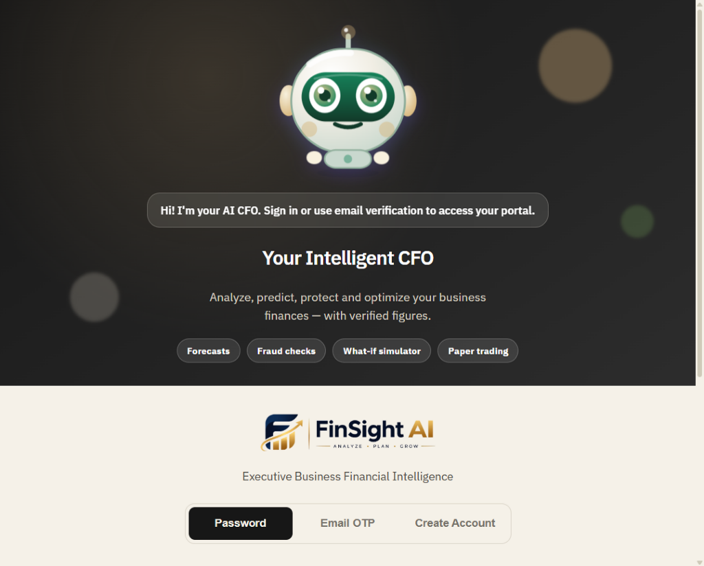

### 3. Multi-Format Financial Document Ingestion Hub
Dropzone supporting `.pdf`, `.docx`, `.xlsx`, `.xls`, and `.csv` files. Extracted data is indexed into vector embeddings with instant status indicators and workspace history.
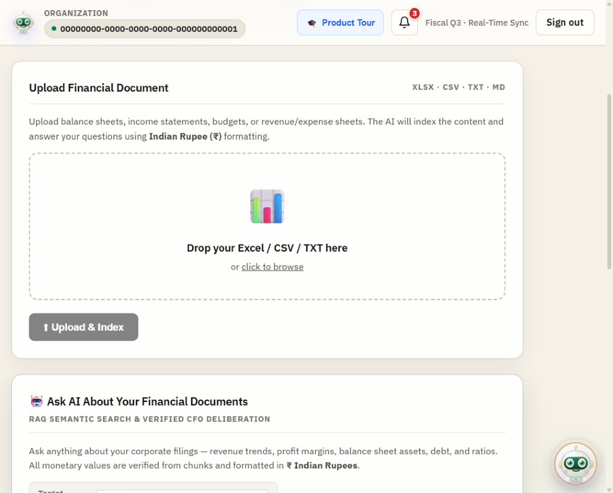

### 4. Executive Financial Dashboard
High-level statement fundamentals matrix, liquidity alerts, revenue/profit trends, and cash balance trajectories for verified corporate filings.
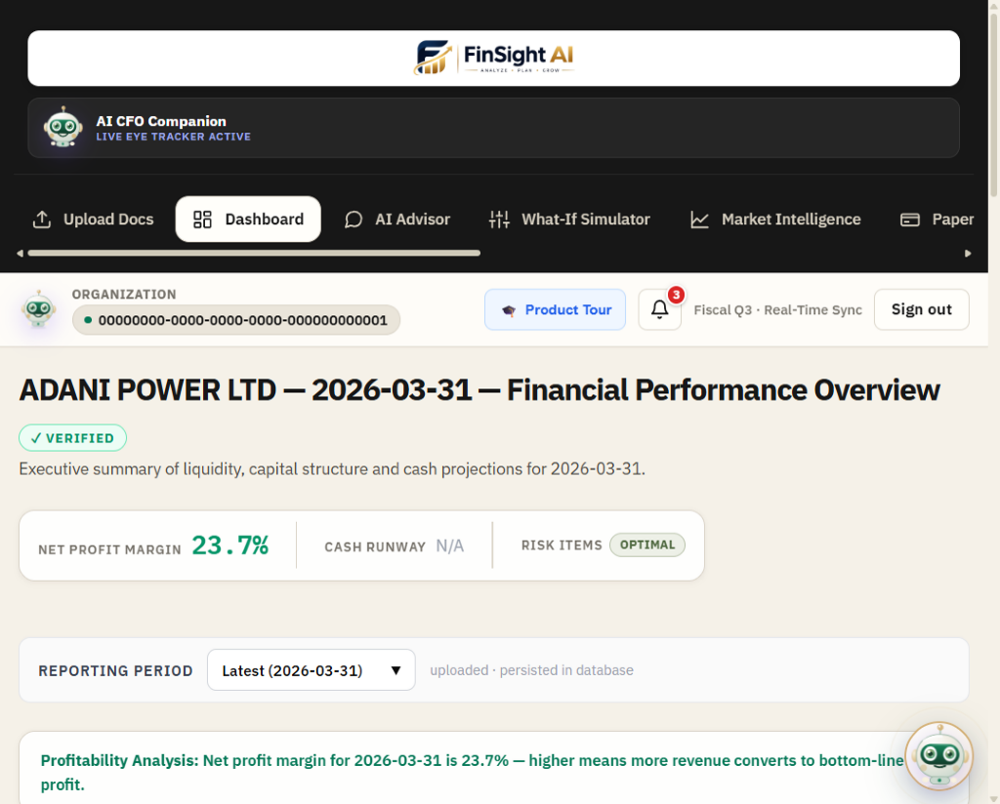

### 5. Detailed Financial Ratios Ledger
Full ledger of 14 computed liquidity, leverage, solvency, and profitability ratios with benchmark interpretations and plain-English summaries.
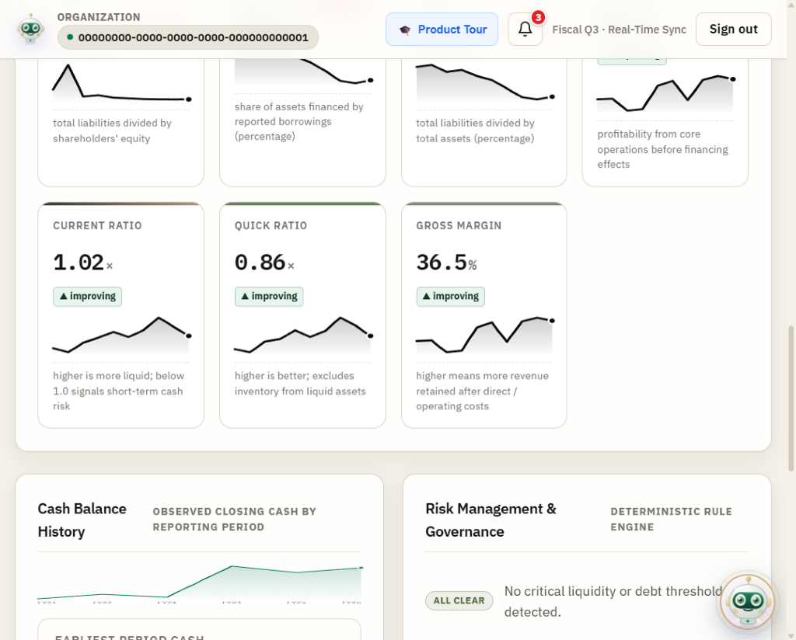

### 6. AI Financial Advisor with Source Citations
Conversational intelligence interface powered by multi-agent RAG deliberation. Every answer references exact Excel sheets, cell coordinates, and verified accounting identities.
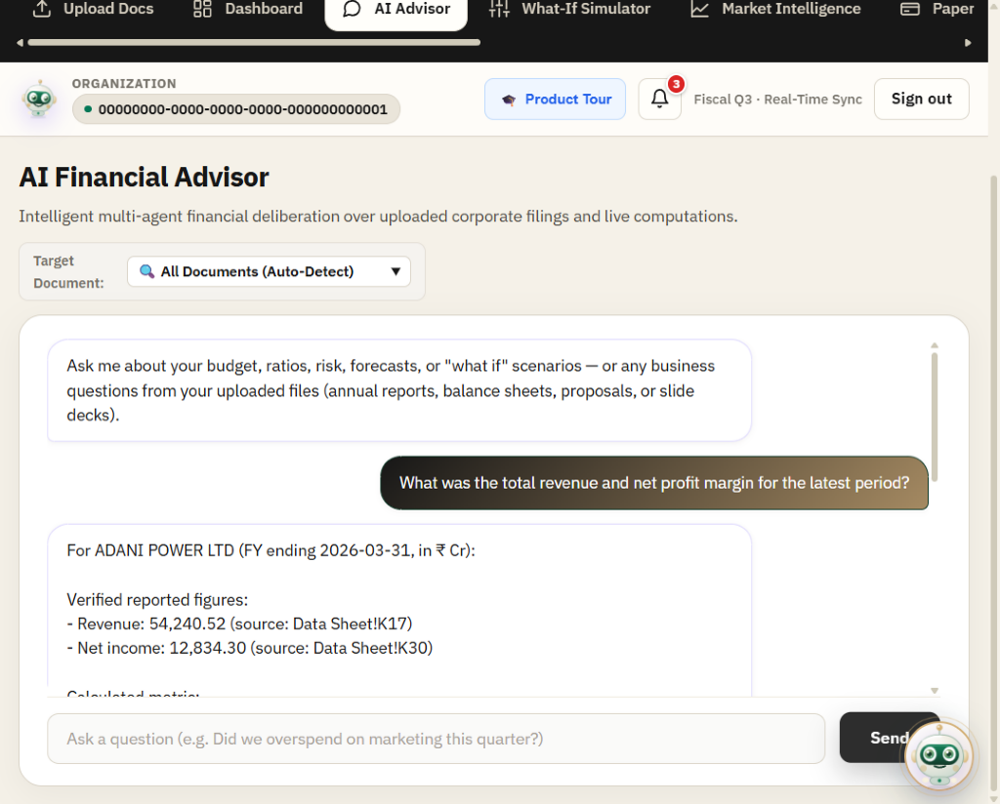

### 7. Causal What-If Scenario Modeling Simulator
Interactive sliders and parameter controls to simulate revenue trajectories, hiring costs, capex outlays, and 12-month terminal cash positions.


### 8. Real-Time Market Intelligence & Equities Screener
NSE/BSE technical analysis suite featuring candlestick charting, SMA/EMA crossovers, RSI momentum, MACD histograms, and ML price forecasting.


### 9. Paper Trading Simulator & Virtual Treasury
Simulate investment strategies and cash treasury allocation without real capital risk. Includes order tickets, market depth, and portfolio performance tracking.
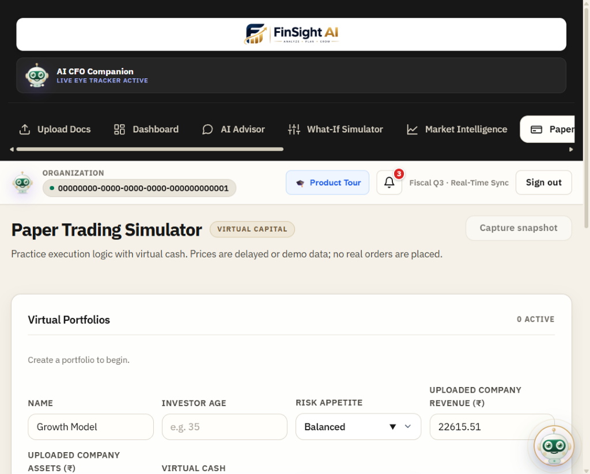

### 10. Corporate Money Management & Liquidity Control
Comprehensive treasury management overview covering cash flow runways, working capital cycles (DSO, DPO, DIO), cost of capital (WACC), and debt amortization.
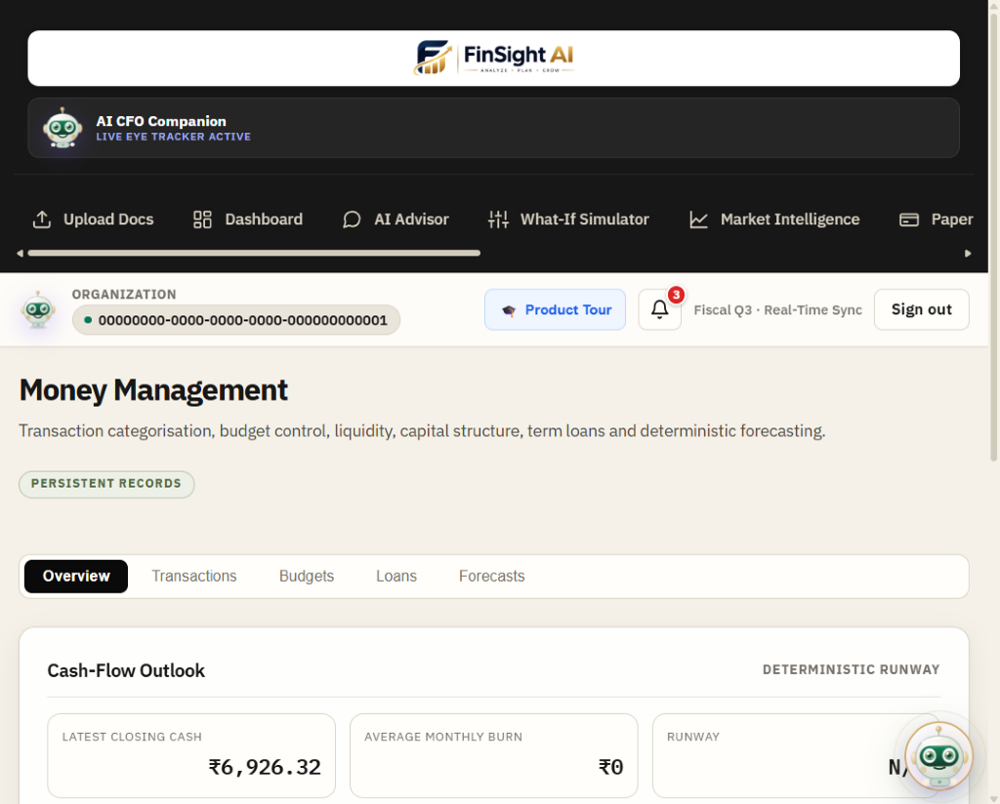

### 11. Transaction Fraud & Forensic Screening Engine
Hybrid ML anomaly detection (Isolation Forest + Random Forest) scanning transactions for duplicate invoices, structuring/smurfing breaches, and Benford's Law distribution outliers.


### 12. Automated n8n Cloud Workflow Orchestration
Event dispatcher and background rule engine connecting file ingestion, risk screens, and automated webhook alerts.


### 13. Executive PDF Financial Reports Generator
Export institutional-grade management reports containing comparative period balance sheets, income statements, ratio analyses, and management commentary.
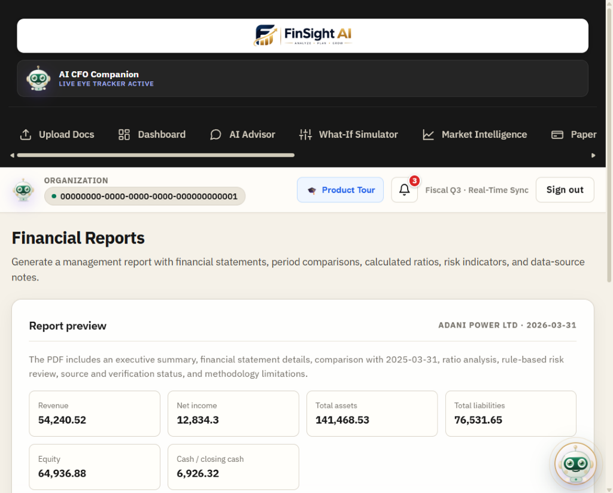

### 14. Real-Time Alert & Risk Monitoring Stream
Audit stream receiving live incident alerts, budget variance notifications, and liquidity warnings from background n8n webhook tasks.
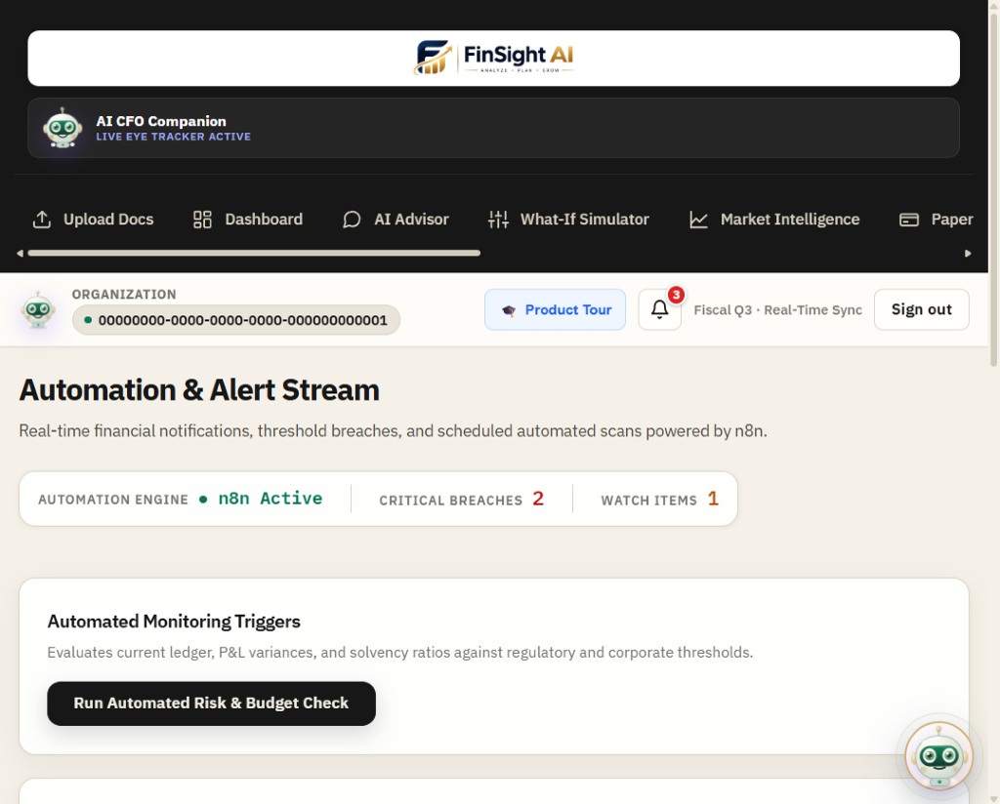

---

## 🏗️ System Architecture & Workflow

FinSight AI employs a decoupled, asynchronous micro-architecture designed for fault tolerance, deterministic verification, and fast client-side rendering.

### End-to-End System Architecture

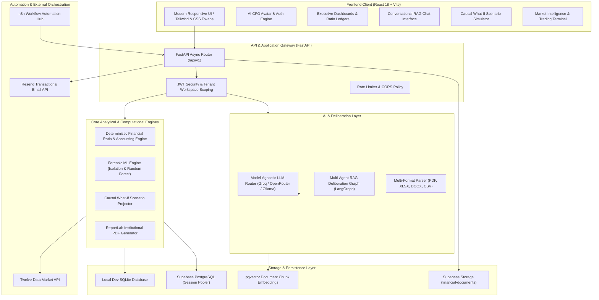

---

### Multi-Agent RAG Deliberation Sequence

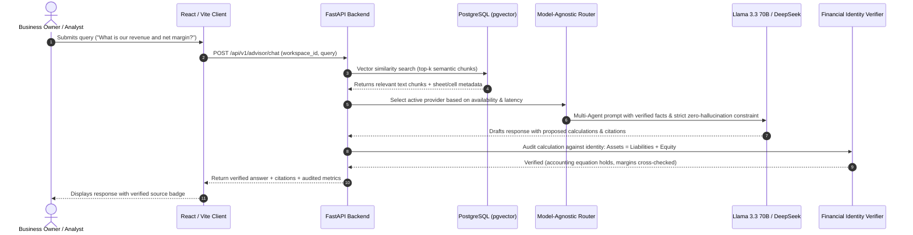

---

### Ingestion & Forensic Fraud Screening Pipeline

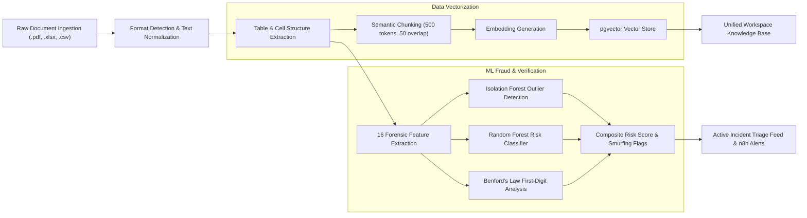

---

### Automation & Incident Escalation Workflow (n8n)

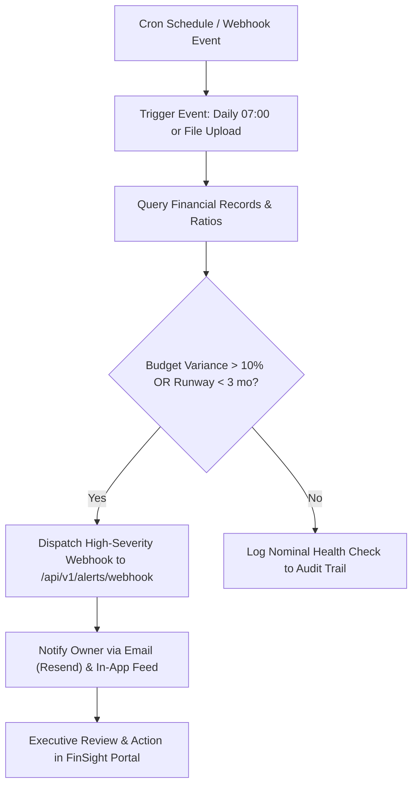

---

## 🛠️ Technology Stack

| Layer | Technologies | Purpose |
|:---|:---|:---|
| **Frontend** | React 18, TypeScript, Vite 5, React Router 6 | High-performance, type-safe single-page web application |
| **Styling & Icons** | Vanilla CSS Tokens, Extended CSS Theme, Lucide Icons | Responsive, dark-aesthetic design system with animated SVG avatars |
| **Backend API** | Python 3.11/3.12, FastAPI, Pydantic v2, Uvicorn | Asynchronous, auto-documented RESTful API microservices |
| **ORM & Database** | SQLAlchemy 2.0 (Async), Alembic, aiosqlite | Asynchronous data persistence with transactional safety |
| **Production DB** | Supabase PostgreSQL with Session Pooler | Hosted relational storage supporting multi-tenant workspaces |
| **Vector Search** | pgvector | High-dimensional embedding storage and cosine similarity indexing |
| **AI Orchestration** | LangGraph, LangChain, Model Router | Multi-agent RAG deliberation and autonomous reasoning workflows |
| **LLM Providers** | Groq (Llama 3.3 70B), OpenRouter (DeepSeek), Ollama | Model-agnostic router with automatic fallback and latency routing |
| **Forensic ML** | Scikit-Learn (Random Forest, Isolation Forest), NumPy | 16-feature anomaly detection and forensic Benford's Law testing |
| **Reporting** | ReportLab | Programmatic vector PDF generation for financial statements |
| **External APIs** | Twelve Data (Market Equities), Resend (Transactional Email) | Live stock feeds and enterprise email deliverability |
| **Automation** | n8n Cloud / Self-Hosted n8n Docker | Background cron tasks, webhook triggers, and event pipelines |
| **DevOps & CI/CD** | GitHub Actions, Docker, Docker Compose, Render | Automated linting, test suites, container builds, and deployments |

---

## 📂 Repository Layout

```text
finsight-ai/
├── .github/
│   └── workflows/
│       └── ci.yml               # Automated CI pipeline (lint, test, build)
├── backend/
│   ├── app/
│   │   ├── api/
│   │   │   ├── routes/          # REST endpoints (auth, advisor, financials, fraud, etc.)
│   │   │   └── deps.py          # Dependency injection & JWT auth extractors
│   │   ├── core/                # Config, security, database session managers
│   │   ├── engines/             # Deterministic financial engines & fraud classifiers
│   │   ├── models/              # SQLAlchemy database ORM models
│   │   ├── schemas/             # Pydantic request/response schemas
│   │   ├── services/            # Document chunking, vector RAG, LLM router
│   │   └── main.py              # FastAPI application entrypoint
│   ├── tests/                   # Backend pytest test suite (unit, integration, RAG)
│   ├── scripts/                 # Evaluation scripts (LLM router reliability evals)
│   ├── requirements.txt         # Python dependencies
│   └── Dockerfile               # Backend container specification
├── frontend/
│   ├── src/
│   │   ├── assets/              # Logos, avatars, and static brand assets
│   │   ├── components/          # Reusable UI components (AICFOAvatar, Cards, Badges)
│   │   ├── lib/                 # API client, AuthContext, session storage
│   │   ├── pages/               # Application route views (Dashboard, Advisor, Fraud, etc.)
│   │   ├── styles/              # Design tokens and theme styling
│   │   ├── App.tsx              # Application route tree
│   │   └── main.tsx             # React entrypoint
│   ├── public/                  # Public icons and manifest
│   ├── package.json             # Frontend dependencies & scripts
│   └── vite.config.ts           # Vite configuration & API proxy
├── docs/
│   └── screenshots/             # High-resolution screenshots of all UI workflows
├── infra/
│   ├── supabase/                # PostgreSQL schema & pgvector initialization SQL
│   └── n8n/                     # Automated n8n workflow exports & setup guide
├── scripts/
│   └── capture_screenshots.js   # Automated screenshot capture script
├── docker-compose.yml           # Local multi-container development environment
├── docker-compose.prod.yml      # Production container orchestrator
├── render.yaml                  # Render Infrastructure-as-Code deployment blueprint
├── LICENSE                      # Official MIT License
└── README.md                    # Primary documentation & architecture guide
```

---

## 🚀 Quickstart & Local Setup

### Prerequisites

Ensure you have the following installed on your machine:
- **Python 3.11 or 3.12**
- **Node.js 20+** and **npm**
- **Docker & Docker Compose** (optional, for full-stack containerization)

---

### Step 1: Clone the Repository

```bash
git clone https://github.com/Lingeshkumar24-code/finsight-ai.git
cd finsight-ai
```

---

### Step 2: Backend Setup

1. Navigate to the backend directory and initialize a virtual environment:
   ```powershell
   cd backend
   py -3.11 -m venv .venv
   .\.venv\Scripts\Activate.ps1
   ```
   *(On macOS/Linux: `python3 -m venv .venv && source .venv/bin/activate`)*

2. Install Python dependencies:
   ```bash
   python -m pip install --upgrade pip
   pip install -r requirements.txt
   ```

3. Configure environment variables:
   ```powershell
   Copy-Item ..\.env.example .env
   ```

4. Start the FastAPI development server:
   ```bash
   uvicorn app.main:app --reload --port 8000
   ```
   - API is running at: `http://localhost:8000`
   - Interactive Swagger docs: `http://localhost:8000/docs`
   - Health check: `http://localhost:8000/health`

---

### Step 3: Frontend Setup

1. Open a new terminal and navigate to the frontend directory:
   ```bash
   cd frontend
   npm install
   ```

2. Configure frontend environment variables:
   ```powershell
   Copy-Item .env.example .env
   ```

3. Launch the Vite development server:
   ```bash
   npm run dev
   ```
   - Frontend is running at: `http://localhost:5175` (or `http://localhost:5173`)
   - Default Demo Credentials:
     - **Email:** `owner@example.com`
     - **Password:** `demo`

---

### Step 4: Full-Stack with Docker Compose (Alternative)

To spin up the complete environment including FastAPI, React, PostgreSQL with pgvector, and n8n:

```bash
docker compose up --build
```

To include local open-weights LLMs via Ollama:
```bash
docker compose --profile local-llm up --build
```

---

## ⚙️ Configuration & Environment Variables

Create a root `.env` file based on `.env.example`. Every variable is validated at startup:

| Variable | Required | Default | Description |
|:---|:---:|:---|:---|
| `ENV` | Yes | `development` | Runtime environment (`development`, `staging`, `production`) |
| `JWT_SECRET` | Yes | `dev-secret-change-me` | Secret key used to sign and verify user JWT tokens |
| `DATABASE_URL` | Yes | `sqlite+aiosqlite:///./finsight.db` | SQLAlchemy async connection string. Use Supabase PostgreSQL in production |
| `SUPABASE_URL` | No | — | Supabase organization URL for storage buckets and cloud vectors |
| `SUPABASE_SERVICE_KEY` | No | — | Supabase service role key (keep secret) |
| `SUPABASE_STORAGE_BUCKET`| No | `financial-documents` | Bucket name for uploaded PDF/XLSX storage |
| `GROQ_API_KEY` | No | — | API key for high-speed Groq inference (Llama 3.3 70B) |
| `OPENROUTER_API_KEY` | No | — | API key for OpenRouter models (DeepSeek, Claude, GPT-4) |
| `TWELVEDATA_API_KEY` | No | — | API key for real-time market quotes and historical equities |
| `N8N_WEBHOOK_URL` | No | `http://localhost:5678/...` | Webhook URL for external alert dispatch |
| `N8N_SHARED_SECRET` | No | `finsight-n8n-secret` | Shared authentication secret sent via `X-N8N-Secret` |
| `RESEND_API_KEY` | No | — | API key for transactional email and OTP dispatch |
| `RESEND_FROM_EMAIL` | No | `FinSight AI <onboarding@resend.dev>` | Verified outbound sender email address |

---

## 🧪 Testing & Quality Assurance

FinSight AI includes comprehensive test suites across both backend engines and frontend user interfaces.

### Backend Test Suite
```bash
cd backend
# Run lint checks
ruff check app tests

# Run unit and integration tests with coverage enforcement
pytest -q --cov=app --cov-report=term-missing --cov-fail-under=75

# Run model router reliability eval
python scripts/eval_llm_router.py
```

### Frontend Test Suite
```bash
cd frontend
# Run TypeScript compilation check
npx tsc -b

# Run Vitest component and integration tests
npm run test

# Validate production bundle build
npm run build
```

---

## 🚢 Production Deployment (Render + Supabase)

The repository includes a ready-to-use `render.yaml` blueprint for automatic deployment on Render:

1. **Database:** Create a Supabase project and apply `infra/supabase/schema.sql` to initialize `documents`, `document_chunks`, and the `pgvector` extension.
2. **Session Pooler:** In Supabase, navigate to **Project Settings → Database → Connection Pooling** and copy the **Session pooler** URI. Configure this as `DATABASE_URL` in Render.
3. **Render Blueprint:** Connect your GitHub repository to Render. Render will automatically provision:
   - `finsight-backend` (Python web service running Uvicorn)
   - `finsight-frontend` (Static site serving the Vite production build)
4. **Environment Secrets:** Populate `JWT_SECRET`, `GROQ_API_KEY`, `TWELVEDATA_API_KEY`, and `N8N_SHARED_SECRET` in the Render environment dashboard.

---

## ⚖️ Legal & Financial Disclaimer

> [!IMPORTANT]
> **FinSight AI is a financial intelligence and decision-support tool.**
> All calculated ratios, anomaly flags, what-if projections, and AI advisor statements are deterministic models based on user-provided corporate records and third-party market data feeds. 
> 
> Outputs generated by FinSight AI do **NOT** constitute:
> - An audit, assurance, or forensic accounting opinion;
> - Legal, regulatory, or tax advice;
> - SEBI or SEC-registered investment advice or buy/sell recommendations.
> 
> Always verify critical numbers against original corporate filings and consult certified financial planners, chartered accountants, and legal counsel before executing financial agreements or capital investments.

---

## 📄 License

This project is licensed under the **MIT License**.

```text
MIT License

Copyright (c) 2026 Lingeshkumar24-code

Permission is hereby granted, free of charge, to any person obtaining a copy
of this software and associated documentation files (the "Software"), to deal
in the Software without restriction, including without limitation the rights
to use, copy, modify, merge, publish, distribute, sublicense, and/or sell
copies of the Software, and to permit persons to whom the Software is
furnished to do so, subject to the following conditions:

The above copyright notice and this permission notice shall be included in all
copies or substantial portions of the Software.

THE SOFTWARE IS PROVIDED "AS IS", WITHOUT WARRANTY OF ANY KIND, EXPRESS OR
IMPLIED, INCLUDING BUT NOT LIMITED TO THE WARRANTIES OF MERCHANTABILITY,
FITNESS FOR A PARTICULAR PURPOSE AND NONINFRINGEMENT. IN NO EVENT SHALL THE
AUTHORS OR COPYRIGHT HOLDERS BE LIABLE FOR ANY CLAIM, DAMAGES OR OTHER
LIABILITY, WHETHER IN AN ACTION OF CONTRACT, TORT OR OTHERWISE, ARISING FROM,
OUT OF OR IN CONNECTION WITH THE SOFTWARE OR THE USE OR OTHER DEALINGS IN THE
SOFTWARE.
```

For full legal terms, refer to the [LICENSE](LICENSE) file.

---

<p align="center">
  Built with ❤️ for modern businesses and financial decision-makers.
</p>
